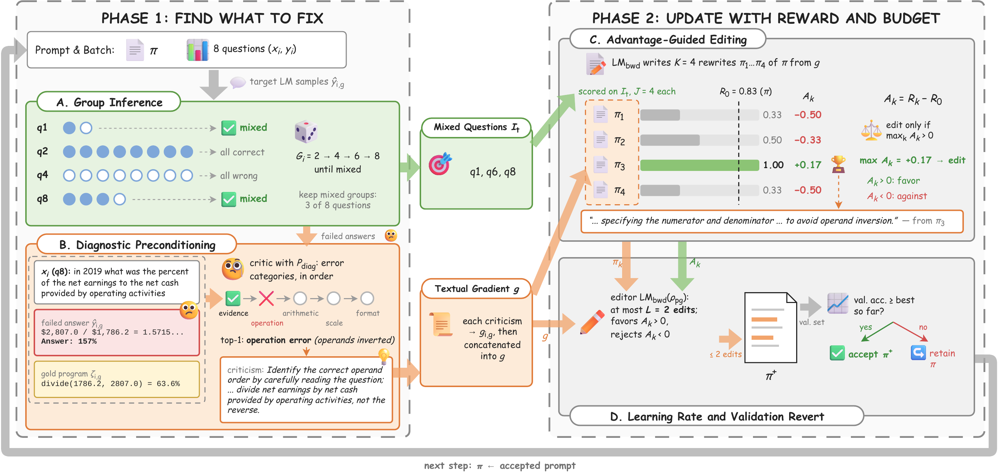

<div align="center">

# TextSteer

### Reliable and Adaptive Prompt Optimization

<!-- Authors, affiliations and paper badges go here once the paper is public. -->

[](LICENSE)
[](https://www.python.org/)

</div>

<div align="center">

</div>

## About

Official GitHub repository for the paper **TextSteer: Reliable and Adaptive
Prompt Optimization**.

## Overview

TextSteer is a textual-gradient prompt optimizer built on
[TextGrad](https://github.com/zou-group/textgrad). It grounds each prompt
update in observed task performance and limits how much of the prompt one
update may change. Each optimization step has four components:

- **group inference** samples 2, 4, 6, then 8 responses per training question
  until some are correct and some wrong, and keeps the questions with mixed
  outcomes;
- **diagnostic preconditioning** has a task diagnoser critique the failed
  responses before TextGrad turns the critique into prompt feedback;
- **advantage-guided editing** scores K = 4 candidate rewrites against the
  current prompt on the selected questions (J = 4 responses each); only if one
  beats the current prompt does the editor revise it, guided by the
  candidates' advantages;
- **the textual learning rate** caps each update at L = 2 distinct edits.

An update is kept only if its validation accuracy is not below the best seen
so far.

The repository contains the TextSteer implementation, its four ablations, the
task diagnosers, and the scripts for the paper's FinQA and Reasoning Gym
experiments. Baseline optimizers are not included.

## Installation

The reference environment uses Python 3.12:

```bash
python3.12 -m venv .venv
source .venv/bin/activate
pip install -r requirements.txt
```

The main dependencies are the OpenAI Python SDK, `reasoning-gym` 0.1.25,
`datasets`, pandas and diskcache. GPT-4.1-mini, the backward model and prompt
editor, is called through the OpenAI API; the target models (GPT-OSS-20B and
DeepSeek-V4-Flash) are called through OpenRouter. Add both keys to `.env`:

```bash
cp .env.example .env   # set OPENAI_API_KEY and OPENROUTER_API_KEY
```

FinQA is downloaded from the [official repository](https://github.com/czyssrs/FinQA)
on first use; Reasoning Gym questions are generated from the seed.

## Quick Start

Run TextSteer on FinQA with GPT-OSS-20B for one seed (about 15 minutes):

```bash
bash scripts/finqa.sh gpt-oss-20b textsteer 47
```

Run an ablation, here without advantage-guided editing:

```bash
bash scripts/finqa.sh gpt-oss-20b wo_age 47
```

Run TextSteer on a Reasoning Gym task (`ab`, `count_primes` or `graph_color`):

```bash
bash scripts/reasoning_gym.sh count_primes textsteer 47
```

Each run writes `results.json` and `run.log` to
`outputs/<benchmark>/<model or task>/<variant>/seed-<seed>/`. Set `OUTPUT_DIR`
to write elsewhere and `PYTHON` to use a non-default Python executable.

## Reproduce Paper Results

Run every experiment in Tables 1 and 2:

```bash
bash scripts/run_paper.sh
```

Or run them one at a time. `VARIANT` is `textsteer`, `wo_group`, `wo_diag`,
`wo_age` or `wo_lr`; seeds default to 47–51 on FinQA and 47–49 on Reasoning Gym.

```bash
# Table 1: FinQA
bash scripts/finqa.sh gpt-oss-20b VARIANT
bash scripts/finqa.sh deepseek-v4-flash VARIANT

# Table 2: Reasoning Gym
bash scripts/reasoning_gym.sh graph_color VARIANT
DIAGNOSTICS=on bash scripts/reasoning_gym.sh graph_color textsteer   # † row
bash scripts/reasoning_gym.sh count_primes VARIANT
bash scripts/reasoning_gym.sh ab VARIANT

# Table 2: test re-evaluation for Count Primes and A::B
bash scripts/reeval.sh count_primes VARIANT    # or "initial" for the initial prompt
bash scripts/reeval.sh ab VARIANT
```

Test accuracy for FinQA and GraphColor is the mean of the last `test_acc` entry
in `results.json` (the first entry is the initial prompt). Count Primes is
re-evaluated with 8,192 output tokens (`test8192.json`) and A::B with medium
reasoning effort and 4,096 tokens (`test4096_medium.json`).

Model responses are cached under `$XDG_CACHE_HOME/textgrad` (default
`outputs/cache`), and a seed whose `results.json` exists is skipped. Responses
are not deterministic even at temperature 0, so fresh runs differ from the
paper by a few points per seed.

## Components and Ablations

`textsteer/run.py` runs the full method by default. Each flag switches one
component off:

| Flag | Variant | Effect |
|---|---|---|
| `--no-group-inference` | `wo_group` | One response per mini-batch question; every question is used. |
| `--no-diagnostic-preconditioning` | `wo_diag` | Generic TextGrad feedback instead of the task diagnoser. |
| `--no-advantage-guided-editing` | `wo_age` | The editor rewrites the prompt directly from the feedback, without candidates. |
| `--no-textual-learning-rate` | `wo_lr` | No limit on the number of edits per update. |

A TextSteer run with the paper's hyperparameters (`scripts/common.sh` also sets
provider routing, timeouts and retries):

```bash
python textsteer/run.py --task FinQA --seed 47 \
  --eval-engine gpt-4.1-mini \
  --test-engine openrouter-openai/gpt-oss-20b --openrouter-reasoning medium \
  --train-size 50 --val-size 50 --test-size 100 \
  --batch-size 8 --epochs 1 --max-steps 3 --eval-temperature 0 \
  --group-temperature 0 --num-candidates 4 --candidate-temperature 0.7 \
  --candidate-responses 4 --edit-budget 2 \
  --use-validation-revert --validation-revert-tolerance 0 \
  --save-results results.json
```

`--task` accepts `FinQA`, `RG_ab`, `RG_count_primes` and `RG_graph_color`;
`python textsteer/run.py --help` lists all options.

`results.json` records, for each step, the selected questions
(`optimized_group_indices`), the candidates with their rewards and advantages
(`candidates`, `candidate_rewards`, `baseline_rewards`, `advantages`; index 0
is the current prompt), the update decision (`improvement_gate`), and the
retained prompt with its validation and test scores (`prompt`,
`validation_acc`, `test_acc`). Keys of a switched-off component are omitted.

## Repository Layout

```text
TextSteer/
├── requirements.txt
├── .env.example                          # API keys
├── textsteer/
│   ├── run.py                            # training loop, group inference, candidate scoring
│   └── reeval.py                         # test re-evaluation of saved prompts
├── textgrad/                             # TextGrad library with TextSteer additions
│   ├── optimizer/
│   │   ├── advantage_guided_editing.py   # advantage-guided editing and edit budget
│   │   └── optimizer_prompts.py          # editor prompts
│   └── tasks/
│       ├── finqa.py                      # FinQA data and answer checker
│       ├── reasoning_gym.py              # Reasoning Gym data and answer checkers
│       └── *_diagnoser.py                # task diagnosers
├── scripts/                              # experiment scripts
└── assets/                               # method figure
```

<!-- Add once the paper is public:
## Citation

If you use TextSteer in your research, please cite:

```bibtex
```
-->

## Acknowledgements

TextSteer builds on [TextGrad](https://github.com/zou-group/textgrad) (MIT
License). We thank the authors of [FinQA](https://github.com/czyssrs/FinQA)
and [Reasoning Gym](https://github.com/open-thought/reasoning-gym) for
releasing their data and task generators.
